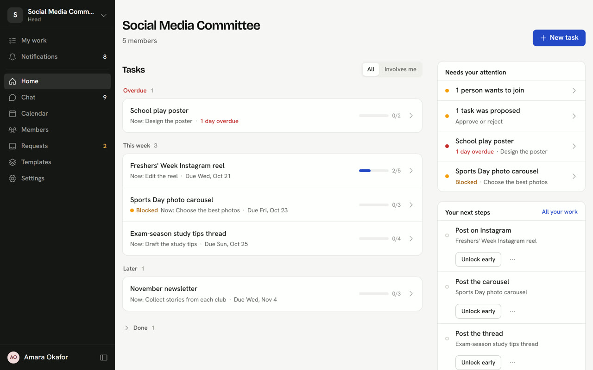
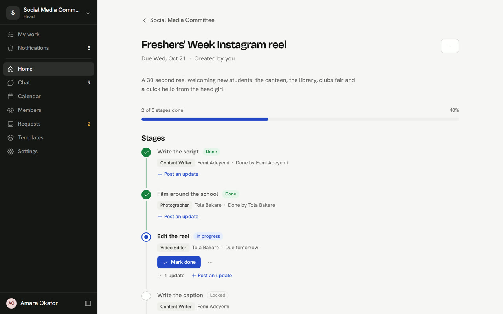
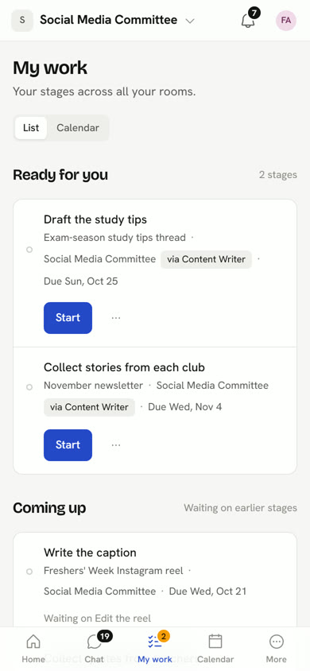
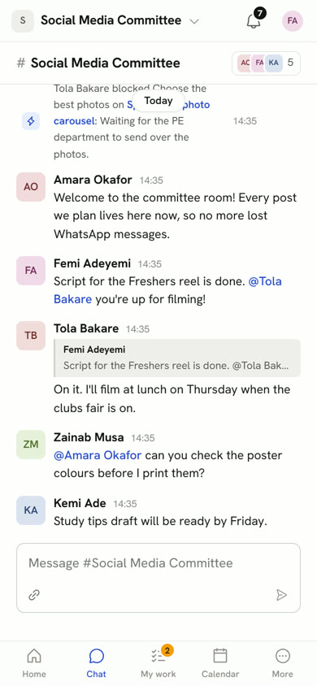

# The Floor

**Every task, stage by stage.** The Floor is a task manager for groups that hand work along: a school committee, a club, a small studio. Each task is split into stages that happen in order, like Script → Film → Edit → Post. When you finish your stage, the next one unlocks and the person who owns it is told straight away, on their phone or laptop.



<table>
  <tr>
    <td width="62%"></td>
    <td></td>
  </tr>
</table>

*Screenshots use invented demo data.*

## What it does

**Rooms and people**
- One private room per team. People join with an invite link and the head approves each request.
- Roles: **head**, **temporary head** (extra rights until a date the head picks) and **member**. The head can hand over the room or delete it.
- Tags such as *Content Writer* or *Video Editor*, so a stage can go to "whoever edits" instead of one named person.

**Tasks and stages**
- Tasks are split into 1 to 30 stages, each with a person or a tag and an optional due date. Stages can also run side by side.
- Stages unlock in order automatically. Heads can unlock one early, or reopen finished work.
- Mark a stage in progress, done, or **blocked** with a reason. Post progress updates with links.
- When a stage is done, link its **result** (YouTube, Google Drive or Docs, Canva, Instagram, TikTok, Vimeo, Loom, or a direct image or video). The next person gets it with their turn, and the task's **Work so far** plays each result in place. Players load only when someone taps them.
- Members **propose** tasks, and heads approve them or send them back with a note.
- **Templates** for the stages a team always uses.

**Seeing what's going on**
- The room home groups tasks into Overdue, This week, Later and Done. It shows heads what *needs your attention* (join requests, proposals, blocked and overdue work), plus your next steps and what's coming up.
- **My work**: your stages across every room, most urgent first, as a list or a calendar. Each room also has its own month calendar.
- Everything updates live for everyone, with no refreshing.

**Chat beside the work**
- One chat per room. Finished, blocked and completed stages post themselves into it.
- @mentions, quote replies (swipe right on a phone), a typing indicator, and links from any message to a task or stage.



**Notifications**
- The bell in the app always shows everything.
- **Email**, grouped so several notifications in a couple of minutes arrive as one message, plus an optional 8am daily summary in your own timezone.
- **Browser push notifications** on phones and laptops, even when the app is closed. On iPhone, add the site to your Home Screen first.
- Per-person switches for requests, decisions, work for you, mentions and replies, and every chat message. Any room can be muted.

**Account**
- Name, timezone, light/dark/system theme, change of email (confirmed by link) and change of password.
- Password reset by email, and sign out on every device.

The phone layout is designed in its own right: a bottom tab bar, menus that slide up as sheets, and large tap targets.

<br clear="right" />

## What's in this repo

| Folder | What it is |
|---|---|
| [`backend/`](backend/) | The API: FastAPI, SQLAlchemy, Alembic and PostgreSQL. Also runs the live-update socket, the email sender and push notifications. See [backend/README.md](backend/README.md). |
| [`frontend-v2/`](frontend-v2/) | **The current web app**: React, TypeScript, Vite, TanStack Query, plain CSS with design tokens. See [frontend-v2/README.md](frontend-v2/README.md). |
| [`frontend/`](frontend/) | The original frontend, kept as it is. New work goes in `frontend-v2/`. |
| `Dockerfile`, `render.yaml` | Production build: one image that serves the app and the API together, deployed on Render. |
| `docker-compose.yml` | A local PostgreSQL for development. |
| [`.claude/skills/`](.claude/skills/) | Design and UI rules for AI coding assistants working on this project (brand, screens and flows, motion). |

## Run it locally

You need **Python 3.11+**, **Node.js 22+** and **Docker** (for the database).

```bash
# 1. Database
docker compose up -d

# 2. Backend: http://localhost:8000 (API docs at /docs)
cd backend
python -m venv .venv
source .venv/bin/activate              # Windows: .venv\Scripts\Activate.ps1
pip install -r requirements.txt
cp .env.example .env                   # then set SECRET_KEY (see below)
alembic upgrade head
python -m scripts.seed                 # optional: a demo room with logins
uvicorn app.main:app --reload --workers 1

# 3. Web app: http://localhost:5174
cd frontend-v2
npm install
npm run dev
```

Make a `SECRET_KEY` with `python -c "import secrets; print(secrets.token_hex(32))"`.

The dev server forwards `/api` (and the live-update socket) to the backend, so the two behave like one site. With the demo data, sign in as `head@example.com` (the head), or as `femi@example.com` or `tola@example.com` (members). The password for every demo account is `password123`.

In development, emails are printed in the backend's log instead of being sent. That's where you'll find password-reset links.

## Tests

```bash
cd backend && python -m pytest -q      # about 600 tests, in-memory SQLite
cd frontend-v2 && npm run build        # type-check and build
cd frontend-v2 && npm run lint
```

## How it fits together

- **One origin.** In production, FastAPI serves the built `frontend-v2` alongside `/api`. The session cookie is `SameSite=Lax`, and the live socket needs the same host, so the site and the API must share one address.
- **One worker.** Live updates and the email/notification loop run inside the API process. Run uvicorn with `--workers 1`; scaling out would need Redis pub/sub first.
- **Permissions live on the server.** Each room sends the current person's permissions, and the app only shows the actions they can take. The server checks every request again.
- **Notifications** are created in the same database transaction as the change that caused them. Bell items appear straight away, emails are grouped and sent by the background loop, and pushes go out after the commit on a small thread pool. The push key is generated on first start and stored in the database.

## Deploying

The repo deploys to **[Render](https://render.com)** as a single Docker web service (`render.yaml`, Frankfurt region, which is close to a Supabase database in AWS eu-west-1):

1. In Render, choose **New → Blueprint** and pick this repo and branch.
2. When asked for `DATABASE_URL`, paste a PostgreSQL connection string (a Supabase pooler URL works as it is).
3. On start, the container runs the database migrations and then one uvicorn worker. The site's address fills in the frontend URL, CORS and the push contact automatically.

To send real email, set `EMAIL_BACKEND=smtp`, `EMAIL_FROM` and the `SMTP_*` settings in Render's Environment tab. Render's free plan blocks the usual mail ports, so use a provider that accepts port 2525 (for example Brevo). On the free plan the service also sleeps after about 15 idle minutes: the first visit after that takes up to a minute, and emails and pushes wait until it's awake.

### The admin page

`/admin` shows staff whether the site is healthy (database, background jobs, email queue, push) and how it's being used: accounts, active people, rooms, tasks, overdue and blocked stages, and an 8-week chart. It shows totals only, never names, task titles or messages. Everyone else gets a 404 from its API, and the page sends them back to their rooms.

Staff can't be granted from inside the app. Run this from `backend/`, with `DATABASE_URL` pointing at the database you mean:

```bash
python -m scripts.staff add you@example.com     # also: list, remove
```

Staff then see **Admin** in their account menu.

## Settings

The main backend settings (see [`backend/.env.example`](backend/.env.example) for the full list):

| Setting | What it's for |
|---|---|
| `DATABASE_URL` | PostgreSQL connection string |
| `SECRET_KEY` | Signs sessions. At least 32 bytes, kept secret |
| `REFRESH_COOKIE_SECURE` | `true` in production (HTTPS), `false` for local plain HTTP |
| `FRONTEND_URL`, `PUBLIC_API_URL`, `CORS_ORIGINS` | Where links in emails point, and which sites may call the API |
| `EMAIL_BACKEND`, `EMAIL_FROM`, `SMTP_*` | `console` prints emails to the log; `smtp` sends them |
| `TRUSTED_PROXIES` | Proxy addresses or ranges whose `X-Forwarded-For` is trusted, so rate limits see real visitors |
| `PUSH_ENABLED`, `VAPID_PRIVATE_KEY`, `VAPID_SUBJECT` | Browser push. Optional: a key is generated and stored on first start |
| `FRONTEND_DIST` | Path to the built frontend to serve from the API (set by the Dockerfile) |

## Branches

`main` is the shared branch. `deploy` carries the latest work and is what Render builds from; merge it into `main` once it's been checked on the live site.
